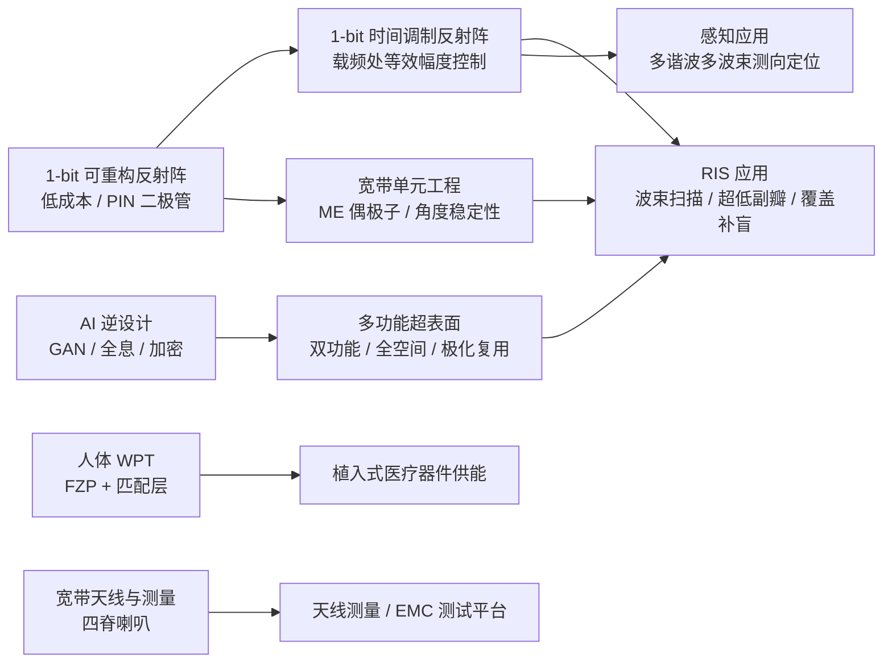
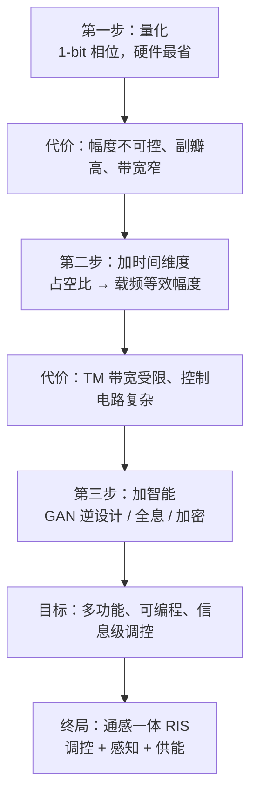

# 曹先博（曹老师）研究方向解读

> 依据：① 导师主页 <https://hz.xidian.edu.cn/info/1277/25374.htm>；② `曹老师论文/` 下 8 篇 PDF 全文（5 篇本人 + 3 篇对标）；③ Crossref / OpenAlex 公开元数据（仅用于补充近年论文清单，见附录 B）。
> 结论以论文原文为准；凡属推断，文中均标注「推断」。
> 版本：2026-10-19 第二版（补入 IEICE ComEX 2023 全文、硬件约束、横向对比、局限表、实验方法论）。

---

## 0. 一句话概括

曹老师做的是**「用最便宜的 1-bit 可重构超表面硬件，把电磁波的相位、幅度、时间三个维度都调起来」**——核心载体是 1-bit 可重构反射阵 / 时间调制反射阵（RIS 的硬件形态），一头接 6G 通感一体与覆盖增强，一头接 AI 逆设计与全息加密（**这一支第一作者是组内的刘小松，他是二作**），另有一条人体无线能量传输（WPT）的应用支线。

三个关键词：**1-bit（低成本）、时间调制（多一个自由度）、载频工作（能直接进现有系统）**。

---

## 1. 他是谁、站在哪条线上

| 项 | 内容 |
|---|---|
| 身份 | 西安电子科技大学杭州研究院，助理研究员；姜文 PI 团队全职博士后 |
| 学历 | 西电本科（2016）→ 西电硕士（2019，天线与微波技术国家重点实验室，导师方向：姜文/龚书喜）→ 日本东北大学博士（2023，Qiang Chen 实验室） |
| 研究自述 | 复杂电磁环境多维调控与智能感知、时间调制反射阵列、可重构智能超表面、下一代终端天线、人体无线能量传输 |
| 项目 | 国自然青年基金、中国博士后科学基金面上、国家博士后研究人员资助计划、陕西省博士后科研资助 |
| 获奖 | IEEE AP-S Japan Student Award；IEICE 天线与传播专委会若手奖励赏 |
| 合作方 | 日本 NTT 空间环境与能源研究所（多篇论文共同作者）；日本 JST OPERA 项目资助 |

这条履历解释了他的**双栖特征**：西电给了天线工程与阵列设计的底子，东北大学给了时间调制/超表面理论（Qiang Chen 组）与 NTT 的工程场景（数据中心、 resilient energy/ICT）。回国后落在姜文团队，自然把「超表面 + 阵列 + AI」接了起来。

---

## 2. 研究地图



一句话读图：**A 是硬件底座，B 是他的学术标签，C/D 是出口场景，F 是近两年新长出来的方法学分支，H/J 是应用与工程支线。**

---

## 3. 五个方向逐条解读

### 3.1 1-bit 时间调制反射阵（TMRA）——招牌工作 ★★★★★

**代表论文**：*A 1-bit Time-Modulated Reflectarray for Reconfigurable-Intelligent-Surface Applications*, **IEEE TAP**, vol. 71, no. 3, 2023（第一作者 + 通讯作者，与 NTT 合作）。

**要解决的问题**（论文 Introduction 说得很直白，两个痛点）：

1. **1-bit 反射阵只能控相位，控不了幅度**。幅度不可控 → 副瓣压不下去、波束赋形能力差，而 RIS 的多场景需求恰恰需要幅度自由度。
2. **传统时间调制阵列（TMA/TMRA）把可控波束搬到了谐波频率**（`fc ± n·fm`）。功能是强了，但工作频率变了，现有 5G/6G 系统没法直接用，得外加滤波和变频。

**核心想法**（这篇论文最漂亮的一步）：

他看到 **1-bit 反射阵的两个反射态（`Ae^{jφ}`、`Ae^{j(φ+π)}`）与 1-bit 时间函数的两个逻辑态（+1/−1）在数学上是同构的**。于是把每个单元的开关按「时间函数」通断，在载频 `fc` 处做傅里叶展开，得到

```
a_mn = 2·τ_mn − 1        （τ_mn 为归一化导通占空比）
```

也就是说：**用占空比 τ 在 0→1 之间连续取值，就能在载频上得到 −1→+1 的等效幅度**，而相位仍只有 0/π 两态。结果是：硬件还是那套 1-bit 反射阵（不增加复杂度），却在载频上白捡了一个**幅度自由度**。

**带来的好处**：

- 可以直接做 Chebyshev / Taylor / 二项式等**幅度加权综合**，把副瓣压到 −30 dB 量级；
- 所需时间序列的动态范围远小于原始电流分布，能实现常规幅度可控反射阵做不到的「电流跳变」分布；
- **工作在载频**，与现有系统兼容（这正是相对前人 TMRA 的关键差异）。

**实测结果**（10×10 原型，X 波段）：

| 指标 | 数值 |
|---|---|
| 工作频率 | 11.1 GHz（载频，不搬频） |
| 波束扫描 | 10°–50° |
| 最大增益 / 口径效率 | 15.6 dBi / 21.1% |
| 散射方向图副瓣 | −20 dB |
| 散射强度损失 | 仅比同尺寸金属板低 1.9 dB（说明效率不亏） |
| 带宽瓶颈 | 不是增益/副瓣带宽，而是 **TM 带宽** |

**硬件与关键约束**（论文里散落但很关键）：

- 原型：**10×10 = 100 单元**，PCB 工艺，每单元 1 只 PIN 二极管 + 独立偏置线；
- 时间调制频率 **`fp = 100 kHz`**；
- **信号带宽必须小于 `fp`**（即 <100 kHz），否则谐波频谱混叠——这是该方案走向实用的最大硬约束，论文自己也承认「随半导体技术发展，更大信号带宽的 TMRA 才能满足更多通信场景」；
- 作者指出 **偏置电路设计是「最大的挑战」之一**：100 路独立控制线，阵列边长翻倍布线量就翻四倍。

**一个值得记住的结论**：1-bit TMRA 的带宽限制来自「时间调制带宽」而非辐射带宽——这直接给后续研究（包括他自己 2025 年 ISAP 的载频波束赋形方法、2026 年 Optics Express 的幅相联合调控时间调制超表面）留了口子。

**紧接着的第二篇（同一套硬件的「感知」用法）**：*DOA Estimation and Object Localization Based on Multi-Harmonic Multi-Beam Characteristic of 1-bit TMRA*，**IEICE Communications Express**, vol. 12, no. 8, 2023（金色 OA，本次已下载）。

- **观察**：1-bit 时间函数做傅里叶展开后，各次谐波（`h = 0, ±1, ±2…`）各自对应一束方向不同的波（multi-harmonic multi-beam, MHMB）；`h≠0` 的系数正比于 `sin(πhτ)/(πh)`，即**谐波幅度里编码了单元的占空比信息**。
- **于是**：目标的角度特征可以被**映射到接收频谱特征**上——角度域 → 频率域。用一套时间序列同时形成多束，就能**一次并行测多个目标的 DOA**（常规方法要逐个波位扫）。
- **意义**：**不增加任何硬件**，把已有的 1-bit TMRA 从「只能通信」升级成「能感知」。这正是他主页写的「智能感知」的落脚点，也踩在 6G 通感一体（ISAC）的点上。

> 这两篇合起来看，逻辑非常清楚：TAP 2023 解决「1-bit 怎么控幅度」，ComEX 2023 解决「1-bit 还能干什么」——从**调控**走向**感知**。

---

### 3.2 宽带 1-bit 可重构反射阵单元（RRA）——工程硬功夫 ★★★★

**代表论文**：*An Ultrawideband 1-Bit Reconfigurable Reflectarray Element With Improved Angular Stability*, **IEEE AWPL**, vol. 25, no. 3, 2026（第一作者，西电杭研院）。

**要解决的问题**：1-bit 的代价是**相位量化损失 + 窄带**。单元带宽不够，整个阵的增益带宽和宽角扫描就上不去；斜入射时相位差还会漂移。

**做法**（三个设计动作，都是「结构化」的巧劲）：

1. 基于**磁电（ME）偶极子**，引入**中心贴片探针结构**，把两只二极管接在探针两侧，分别控制两个谐振模式；
2. 结构**完全对称** → 两个模式的电流分布平衡、稳定 → 1-bit 相位响应急剧宽带化；
3. 单元两侧加**金属过孔墙** → 抑制斜入射时的相位漂移，提升**角度稳定性**。

**结果**：

| 指标 | 数值 |
|---|---|
| 1-bit 相对相位带宽 | **58%**（8.97–16.44 GHz） |
| 斜入射 50° 下保持带宽 | 33% |
| 验证方式 | 1×2 原型 + 矩形波导法（RWG）实测 |
| 系统级 | 16×16 阵列仿真：增益带宽与宽角扫描显著改善 |

**同一方向的相邻工作**（都在他 2024–2026 的产出里）：低剖面 1-bit 一维导波馈电**透射阵**（TechRxiv 2024）、极低剖面电可重构一维 **漏波天线**（IET MAP 2025）、**极化复用**超宽带 1-bit 反射+吸波超表面（AWPL 2026）。

**这一支的方法论**：单元级别抠三个指标——**相位带宽、角度稳定性、剖面/成本**；然后一定要走到 16×16 以上的阵列级验证，否则只是「单元论文」。

---

### 3.3 AI 驱动的超表面逆设计 ★★★（组内方向，**第一作者不是他**）

**先澄清一个容易被误读的点**：这一支的 5 篇，**第一作者都是刘小松（Xiao-Song Liu）**，曹老师是**第二作者**，其后是陶洪、姜文。也就是说，这是**组内学生主导**的线，他的角色更接近合作/指导，而非本人一作。如果你冲着「AI 方向」去找他，最好先问清这条线现在归谁带。

**5 篇分别做了什么**（据 Semantic Scholar 公开摘要）：

| 年份 | 论文 | 核心方法 | 做了什么 |
|---|---|---|---|
| 2024 | AWPL：Inverse Design of Bifunctional Metasurfaces | **WGAN-GP**（Wasserstein 距离 + 梯度惩罚）+ **GADF** 编码 | 用格拉姆角差场把 1D 电磁响应转成 2D 图像，把超表面设计变成「图像识别」问题；宣称训练稳定性优于常规 GAN |
| 2024 | OE：Quad-Channel Full-Space Metasurface | **DCGAN** | 一次设计四通道、全空间（透射+反射）超表面 |
| 2024 | ISAPE：Freeform Metasurfaces for Holographic Imaging | **前向网络 + 逆向网络串联（tandem）** | 用串联结构缓解逆设计的「非唯一性」；10 / 15 GHz 分别投出字母 T、F 的全息图 |
| 2025 | ISAP：Multifunctional Metasurfaces | GAN + GADF | 各向异性 meta-atom，对两个正交极化独立给相位；双功能全息 X / Y |
| 2026 | ACS AMI：Information Encryption | **自编码器（AE）+ 多自由度复用** | 超表面当「物理密钥」，OAM / 极化 / 频率多通道复用，再叠一层算法加密 |

**这一支的技术骨架**（三篇 GAN 论文共有的套路）：

1. **数据表示**：`GADF` 把 1D 相位响应用格拉姆角差场编成 2D 图像——这是他们的「独门」处理，让 CNN 能直接吃周期相位数据；
2. **网络**：生成器出结构、判别器判「像不像真解」，或用前向-逆向串联绕开一对多；
3. **验证**：用字母全息图（T/F、X/Y）做可视化证据。

**意义**：从「设计一个单元」升级到「设计一条信息通道」（加密、复用），这是超表面里较前沿的落点。

**注意**：以上基于公开摘要（Semantic Scholar），**全文仍未获取**；训练集规模、设计精度、与传统优化的定量对比都没有核实。

---

### 3.4 人体无线能量传输（WPT）——应用支线，但做得系统 ★★★★

**代表论文**：*A Systematic Method for Efficient Wireless Powering to Implantable Biomedical Devices*, **IEEE TAP**, vol. 71, no. 3, 2023（第一作者 + 通讯作者）。

**问题拆解**（这是他的一贯风格：先把损耗**物理分解**，再逐个对症下药）：

```
发射 → 空气 → [皮肤界面反射] → 组织内衰减 → 植入器件
                    ↑                  ↑
              AL-AML 人工匹配层      FZP 菲涅尔区板聚焦
```

- **组织内衰减** → 用 **FZP（菲涅尔区板）** 做空间聚焦，补偿衰减；
- **界面反射** → 用**空气层-人工匹配层（AL-AML）** 做阻抗匹配，压低反射。

**结果**（植入深度 20 mm，间距 90 mm）：

| 方案 | S21 提升 | 相对接收功率 |
|---|---|---|
| 只用 FZP | 5.9 dB | — |
| 只用 AL-AML | 3.9 dB | — |
| **系统法（FZP+AL-AML）** | **11.6 dB（14.45×）** | **12 dB（15.8×）** |

并且验证了**错位容忍度**（实际植入场景必然对不准）。论文明确说：天线本身的优化留作 future work——**这是一个现成的、可接着做的口子**。

**生物安全这条线他也做了**：工作频率 **2.45 GHz**（ISM），`psSAR`（10 g 组织平均）实测 Original / FZP / AL-AML 分别为 **0.48 / 0.8 / 0.9 W/kg**，都低于 IEEE 限值 2 W/kg；但**整机系统法为 2.43 W/kg，略超标**——论文直接写明「应降低发射功率」。这是他自己承认的落地约束，也是后人做实用化必须解决的问题。

---

### 3.5 宽带天线与测量工程 ★★★

**代表论文**：*Broadband 2 GHz to 14 GHz Dual-Polarized Horn Antenna With Stable Unidirectional Radiation Patterns*, **IEEE AWPL**, vol. 25, no. 2, 2026（第一作者）。

**做什么**：2–14 GHz（7:1）**双极化四脊喇叭（QRH）**，面向**天线测量与 EMC 测试**（做标准增益喇叭/源天线）。

**三个设计动作**：金属环形匹配块（宽带阻抗匹配）＋ 脊根部双金属桥（补偿两端口馈电高度不等引起的失配）＋ 四阶 Bezier 脊型线 + 缩短侧壁（抑制高次模、消除高频方向图分裂）。

**结果**：|S11| < −10 dB，端口隔离 > 30 dB，增益 6.3–19.3 dBi，全带方向图对称无分裂。

**意义别小看**：这类「测量用喇叭」是实验室的基础设施。能自己设计并实测 7:1 的双极化标准喇叭，说明他**具备完整的微波暗室测量能力**——这对带学生做超表面实测非常关键（后面 3.2 的 RWG 法、3.1 的 10×10 阵列实测都依赖这套能力）。

---

### 3.6 六篇的横向对比：同一套评价体系，不同位置

| 论文 | 一句话问题 | 核心手段 | 最硬的指标 | 定位 |
|---|---|---|---|---|
| TAP 2023 TMRA | 1-bit 控不了幅度；TM 阵列搬频 | 占空比 → 载频等效幅度 `a=2τ−1` | 15.6 dBi / 21.1%；SLL −20 dB | **方法论内核** |
| ComEX 2023 | TMRA 只会通信、不会感知 | 多谐波多波束 → 角度域映到频域 | 多目标并行 DOA（未实测） | **感知入口** |
| AWPL 2026 单元 | 1-bit 窄带、斜入射相位漂 | ME 偶极子 + 对称探针 + 过孔墙 | 58% 相位带宽；50° 下 33% | **硬件底座** |
| TAP 2023 WPT | 组织衰减 + 界面反射 | FZP 聚焦 + 人工匹配层 | +12 dB / 15.8× | **应用出口** |
| AWPL 2026 喇叭 | 宽带喇叭方向图分裂 | 环形匹配块 + 双桥 + Bezier 脊 | 7:1，隔离 >30 dB | **测量基础设施** |
| *(对标)* TAP 2022 Luk 组 | 1-bit 宽带化 | ME 偶极子 + 单二极管 | 38.4% 带宽，±60° 扫描 | 他 2026 单元论文的直接对标 |

这张表值得存下来：**开题时你的第 4 行就得是「创新点在哪一列」**。

---

## 4. 贯穿的技术逻辑：三步走



这条链的**内在逻辑非常连贯**：每一次「降成本」都主动暴露一个新自由度，再用下一个维度补回来。1-bit 省了硬件 → 用时间调制补幅度；时间调制带来带宽问题 → 用宽带单元设计补；单元设计靠试错太慢 → 用 AI 逆设计补（这一步由组内刘小松主导，他为二作）。**这就是一个成熟课题组的「问题链」写法**，也是你写开题报告时最该学的东西。

### 4.1 实验方法论：他是怎么「证明」的

这套流程几乎可以原样照搬到你自己的课题：

```
单元级 ── 周期边界全波仿真（斜入射 0°→50° 扫角）
        └ 矩形波导法（RWG）实测 1×2 原型的反射相位
阵列级 ── PCB 加工 10×10 / 16×16 + 偏置板 + 控制板（移位寄存器 + FPGA）
        └ 暗室远场测方向图 / 增益 / 交叉极化
系统级 ── 数值仿真外推到更大口径（省加工费）
生物级 ── 仿体（SPEAG HBEL）+ psSAR 评估（对照 IEEE 2 W/kg）
误差级 ── 给出幅度误差 ΔA、相位误差 Δφ 对副瓣的敏感度曲线
```

**几个可直接抄的细节**：

- **单元一定要有独立实测**（RWG 法），否则审稿人会怀疑「仿真相位差是算出来的不是测出来的」；
- **阵列实测要配误差分析**：TAP 2023 专门分析了 `A₋₁ = A₁e^(−ΔA/20)`、`φ₋₁ − φ₁ = 180° + Δφ` 时副瓣怎么变——这一节是全文最能体现「懂行」的地方；
- **承认原型缺陷但不承认概念缺陷**：论文里两次出现「这是加工原型的控制电路设计失误，不是所提概念的缺陷」——这种写法既诚实又守住结论，值得学；
- **凡做不到的，明确写成 future work**（天线优化、更大信号带宽、更准二极管建模），既划清边界又给后人留位置。

---

## 5. 领域坐标：同行在同一条赛道上做到哪了

文件夹里另外 3 篇**不是他的论文**，但正好是同赛道的「基准线」（详见附录 A）。把它们和他自己的工作放一起，能看出 1-bit RRA 的通行评价体系：

| 工作 | 类型 | 关键指标 | 出处 |
|---|---|---|---|
| Zhou et al.（西电） | 1-bit RRA 阵 | 22.5% 1-dB 增益带宽，25% 口径效率，Ku 波段 16×16 | AWPL 2022 |
| Xiang, Dai, Luk（香港城大） | ME 偶极子 1-bit RRA | 38.4% 3-dB 带宽，24% 口径效率，E 面 ±60° 扫描 | TAP 2022 |
| Shi et al.（西交大） | 超宽带悬挂式 1-bit RIS | 2.75–6 GHz，180°±30°，±60° 扫描 | AWPL 2024 |
| **Cao et al.（本人）** | 超宽带 1-bit 单元 | **58% 相位带宽**，50° 斜入射仍保 33% | AWPL 2026 |

**评价体系就四把尺子**：① 1-bit **相位带宽**；② **扫描角**（尤其斜入射/宽角）；③ **口径效率**；④ **系统复杂度与成本**（二极管数量、控制板、馈电方式）。谁能在不牺牲 ④ 的前提下把 ①②③ 推高，谁就赢。

### 5.1 作者自己承认的局限（挑课题先看这张表）

| 论文 | 自述局限 | 意味着什么 |
|---|---|---|
| TAP 2023 TMRA | 信号带宽须 < `fp`（100 kHz）；口径效率被 **1-bit 量化损失 + 二极管损耗**卡死；偏置电路是最大挑战；小口径下馈源遮挡明显 | **通信实用性**是最大短板；宽带/低损耗 1-bit 方案是空白 |
| ComEX 2023 | 「方法有效性**尚需进一步实验验证**」 | 感知这条线**只做了理论与数值**，实测系统是现成缺口 |
| AWPL 2026 单元 | 实测只做到 **1×2**；16×16 的 22.1 dBi / 31.4% 口径效率**全是仿真** | 阵列级实测是下一步；也是你能接手的具体活 |
| TAP 2023 WPT | 整机 **psSAR 2.43 W/kg > 2 W/kg** 限值；匹配层受基板厚度限制；FZP 超过 3 环不再增益；对横向错位敏感 | 实用化必须做功率/结构折衷；错位鲁棒性是开放问题 |
| AWPL 2026 喇叭 | 未见明显自述局限（7:1 已是同类较好水平） | 工程完成度高，属「稳」的一篇 |

> 读法建议：**局限段 = 选题金矿**。上面第 1、2、4 行的任意一条，都足够支撑一个硕士课题。

---

## 6. 如果你要跟进：入门路径与可能的空白

**能力栈（按优先级）**：

1. **全波仿真**：HFSS / CST 熟练到能独立跑单元 + 16×16 阵列 + 斜入射周期边界；
2. **电路与版图**：PIN 二极管选型、偏置网络、控制板（FPGA/单片机 + 移位寄存器）——他的每篇实测论文都卡在这一步；
3. **测量**：波导法（RWG）测单元反射相位、暗室测阵列方向图、近场/远场换算；
4. **编程**：Python（numpy + PyTorch，做 GAN 逆设计）、MATLAB（方向图综合：Chebyshev/Taylor）。

**三个可切入的空白**（推断，均有论文原文支撑）：

1. **TM 带宽**：他自己指出带宽瓶颈是时间调制带宽 → 做「宽带 1-bit TMRA」或「降低开关速度要求的编码策略」是明确缺口；
2. **TMRA 的感知能力**：2023 年 IEICE 那篇用多谐波多波束做 DOA/定位，但只是可行性验证 → **通感一体（ISAC）的实测系统**几乎空白；
3. **AI 逆设计 + 可重构**：现有 GAN 工作多设计**无源**超表面（且这条线是刘小松一作）→ 把逆设计用到**含二极管的可重构单元**上（带器件非线性、加工容差）是硬骨头，也是高分文章的位置。

**读论文的顺序建议**（如果你只有一周）：

```
TAP 2023 TMRA（读懂 a=2τ−1 的推导，这是全组的方法论内核）
  → AWPL 2026 单元（学会单元设计流程与 RWG 实测）
  → TAP 2023 WPT（学会「损耗分解 → 对症下药」的写法）
  → 其余按兴趣
```

---

## 7. 附录 A：8 篇 PDF 归属核对（重要）

| # | 文件 | 第一作者 | 是否曹老师 | 期刊/年份 |
|---|---|---|---|---|
| 1 | A_1-bit_Time-Modulated_Reflectarray... | **Xianbo Cao**（通讯） | ✅ 本人 | IEEE TAP, 2023 |
| 2 | A_Systematic_Method_for_Efficient_Wireless_Powering... | **Xianbo Cao**（通讯） | ✅ 本人 | IEEE TAP, 2023 |
| 3 | An_Ultrawideband_1-Bit_Reconfigurable_Reflectarray_Element... | **Xianbo Cao** | ✅ 本人 | IEEE AWPL, 2026 |
| 4 | Broadband_2_GHz_to_14_GHz_Dual-Polarized_Horn... | **Xianbo Cao** | ✅ 本人 | IEEE AWPL, 2026 |
| 5 | A_Wideband_1-Bit_Reconfigurable_Reflectarray_Antenna_at_Ku-Band | Shi-Guo Zhou 等（西电） | ❌ 非本人 | IEEE AWPL, 2022 |
| 6 | A_Wideband_Low-Cost_Reconfigurable_Reflectarray_Antenna_With_1-Bit_Resolution | Bing Jie Xiang, Kwai-Man Luk（城大） | ❌ 非本人 | IEEE TAP, 2022 |
| 7 | An_Ultrawideband_1-Bit_Suspended_Reconfigurable_Intelligent_Surface... | Hongyu Shi 等（西交大） | ❌ 非本人 | IEEE AWPL, 2024 |

第 5–7 篇是**同方向对标文献**（不是曹老师写的），建议保留作为背景/对比，但不要写进「曹老师论文列表」。另外，PDF 页脚显示这些是从 **XIDIAN UNIVERSITY** 机构权限下载的（2026-09 下载），说明你用的是学校图书馆的 IEEE 订阅。

**第 8 篇（本次新增）**：`2023_IEICE_COMEX_DOA_TMRA.pdf` —— IEICE Communications Express 2023，金色 OA，J-STAGE 直接下载。这是他「感知」那条线的唯一可获取全文（详见 §3.1 末段）。

**他的论文在文件夹里还缺这些**（据公开元数据，见附录 B）：2021 ISAP、2024 ISAPE、2024 APCAP、2025 ISAP×2、2024/2026 AWPL 若干、AI 逆设计那一支（OE 2024、ACS AMI 2026 等）。其中只有 IEICE ComEX 2023 是 OA 已补下，其余 14 篇的下载状态与链接见同目录 `待下载清单.html`。

---

## 8. 附录 B：公开元数据补充清单（Crossref / OpenAlex，未逐篇核对全文）

| 年份 | 论文 | 刊物/会议 | DOI |
|---|---|---|---|
| 2021 | Design of Multifunctional Reflectarray Elements Based on the Switchable Ground Plane | ISAP | 10.23919/ISAP47258.2021.9614460 |
| 2023 | DOA Estimation and Object Localization Based on Multi-Harmonic Multi-Beam Characteristic of 1-bit TMRA ✅已下载 | IEICE ComEX | 10.1587/comex.2023TCL0008 |
| 2024 | Inverse Design of Bifunctional Metasurfaces Using Improved GANs | IEEE AWPL | 10.1109/LAWP.2024.3508094 |
| 2024 | DCGAN-Assisted Inverse Design of Quad-Channel Full-Space Metasurface | Optics Express | 10.1364/OE.541287 |
| 2024 | Deep Learning-Driven Design of Freeform Metasurfaces for Holographic Imaging | ISAPE | 10.1109/ISAPE62431.2024.10841285 |
| 2024 | Low-Profile and Wideband Bessel Beams Generator with OAM | APCAP | 10.1109/APCAP62011.2024.10881350 |
| 2024 | A Low-Profile 1-bit 1-D Guided Wave Fed Reconfigurable Transmitarray (预印本) | TechRxiv | 10.36227/techrxiv.172710059.98750657/v1 |
| 2025 | GAN-Enabled Inverse Design of Multifunctional Metasurfaces | ISAP | 10.23919/ISAP63122.2025.11362042 |
| 2025 | A Beam-Forming Method for 1-bit TMRA at Carrier Frequency | ISAP | 10.23919/ISAP63122.2025.11361784 |
| 2025 | An Extremely Low-Profile Electronically Reconfigurable 1-D X-Band Leaky-Wave Antenna | IET MAP | 10.1049/mia2.70013 |
| 2026 | Time-Modulated Metasurfaces with Both Amplitude and Phase Control at Carrier Frequency | Optics Express | 10.1364/OE.581263 |
| 2026 | Hybrid Physical and Algorithmic Codesign for Information Encryption via Multiplexed Meta-Holography | ACS AMI | 10.1021/acsami.5c26257 |
| 2026 | A Polarization-Multiplexed Reconfigurable Metasurface with Ultra-Wideband 1-Bit Reflection and Absorption | IEEE AWPL | 10.1109/LAWP.2026.3729810 |
| 2018 | Multi-band Unbroken Metallic Rim Antenna with 3-D PIFA Branch for Smartwatch | EuCAP（IET） | 10.1049/cp.2018.0432 |
| 2020 | Multiband Terahertz Absorbers Using T-shaped Slot-Patterned Graphene | JOSA B | 10.1364/JOSAB.404062 |

> 注意：OpenAlex 把一位**四川大学同名作者**（无线可充电传感器网络、强化学习充电调度，2020–2021 三篇：Ad Hoc Networks / IPDPS / ACM TOSN）合并进了同一条作者记录，已剔除——那不是我方曹老师。

---

## 9. 局限与待核实

- 3.3 节（AI 逆设计）这一支 **5 篇均未获取全文**，但已通过 Semantic Scholar 拿到摘要，方法与内容已可判断（第一作者均为刘小松）；训练集规模、精度、与传统优化的定量对比仍未核实；
- 附录 B 的清单来自 Crossref/OpenAlex 元数据，个别条目的作者身份未逐篇核对（尤其 2018 EuCAP 与 2020 JOSA B，属早期工作）；
- 论文中的「他引/被引」「团队分工」未做分析；
- 他的 2025 ISAP「载频波束赋形方法」很可能就是 TAP 2023 的延续（推断），建议补读全文确认。
